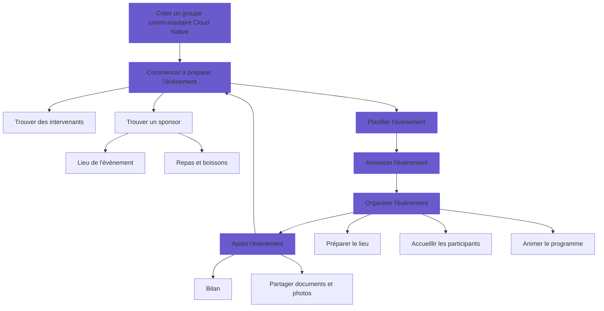

# Bonnes pratiques

Ce guide accompagne la gestion d'un nouveau Cloud Native Community Group à partir de l'expérience des groupes existants. Le schéma illustre les étapes habituelles de l'organisation d'un meetup. Des étapes supplémentaires peuvent être nécessaires selon sa taille.



Les étapes sont détaillées ci-dessous.

- [0. Créer le groupe communautaire Cloud Native](#0-créer-le-groupe-communautaire-cloud-native)
- [1. Commencer à préparer l'événement](#1-commencer-à-préparer-lévénement)
  - [Trouver des intervenants](#trouver-des-intervenants)
  - [Sponsors](#sponsors)
    - [Dossier de sponsoring](#dossier-de-sponsoring)
- [2. Planifier un nouvel événement](#2-planifier-un-nouvel-événement)
  - [Réservations](#réservations)
- [3. Annoncer l'événement](#3-annoncer-lévénement)
  - [Billetterie](#billetterie)
- [4. Organiser l'événement](#4-organiser-lévénement)
  - [Préparation](#préparation)
  - [Présentation de l'événement](#présentation-de-lévénement)
  - [Animation de l'événement](#animation-de-lévénement)
- [5. Après l'événement](#5-après-lévénement)
- [Listes de vérification des hôtes et organisateurs CNCF](#listes-de-vérification-des-hôtes-et-organisateurs-cncf)
  - [Liste de vérification de l'hôte](#liste-de-vérification-de-lhôte)
  - [Liste de vérification de l'organisateur](#liste-de-vérification-de-lorganisateur)
- [Remarques générales](#remarques-générales)
  - [Objets promotionnels CNCF](#objets-promotionnels-cncf)
  - [Demander de l'aide](#demander-de-laide)

## 0. Créer le groupe communautaire Cloud Native

Le personnel CNCF est responsable de la création des groupes communautaires Cloud Native (consultez [README.md](./README.md)). Pour connaître les différents droits d'administration et savoir qui peut créer un groupe, consultez la [documentation OCGroups](https://ocgroups.dev/docs#/getting-started/choose-dashboard?id=how-to-pick-the-right-workspace).

Il est utile de créer un canal Slack communautaire `#cloud-native-<nom-de-ville>` pour coordonner les événements ([Slack CNCF](https://app.slack.com/client/T08PSQ7BQ/C015WPLD3F1)).

Avant de promouvoir votre groupe, consultez [branding.md](./branding.md) pour le logo officiel, les conventions de nommage et les autres ressources graphiques.

La **description** du groupe est laissée à l'appréciation des organisateurs. Vous pouvez y ajouter une brève présentation du rôle de la CNCF et de l'approche cloud native, en vous inspirant de la [définition du cloud native](https://github.com/cncf/toc/blob/master/DEFINITION.md).

Le plus important est de maintenir un **groupe actif**, avec des événements fréquents : idéalement une fois par mois, et au minimum une fois tous les 90 jours. Les événements virtuels comme les meetups réguliers sont encouragés.

Il peut être difficile de faire vivre un groupe seul. Il est préférable de s'entourer de coorganisateurs motivés et engagés. Travailler ensemble permet de répartir la charge et d'élargir le réseau.

## 1. Commencer à préparer l'événement

### Trouver des intervenants

Mettez à disposition un **formulaire** permettant de proposer une intervention. Un [formulaire francophone de proposition d'intervention Cloud Native](https://forms.gle/v9UtxAdhhXuVByhB9) est disponible.

> **Remarque :** ce formulaire est une adaptation communautaire francophone, distincte du formulaire d'origine. Pour votre propre chapitre, vous pouvez en créer une copie et l'adapter à vos besoins.

**Conseil :** Sessionize propose une licence communautaire à laquelle vous pouvez candidater si vous organisez des événements gratuits. [En savoir plus](https://sessionize.com/playbook/community-license).

Dans la mesure du possible, relisez les présentations des intervenants et respectez toujours les valeurs de la CNCF en matière de neutralité vis-à-vis des fournisseurs.

Dans le contexte d'une conférence, la **neutralité vis-à-vis des fournisseurs** consiste à maintenir un environnement impartial, notamment lorsque plusieurs produits, services ou solutions sont évoqués. Le contenu ne doit pas subir d'influence indue ni devenir une publicité ou une recommandation commerciale pour un fournisseur particulier.

Cette neutralité donne la priorité au partage des connaissances et à l'apprentissage plutôt qu'aux intérêts commerciaux, au bénéfice des participants et de l'ensemble du secteur.

Participez à des **conférences** comme DockerCon ou CloudNativeCon : vous pourrez y rencontrer des intervenants potentiels et des personnes qui utilisent les projets CNCF ou y contribuent et pourraient rejoindre votre groupe.

### Sponsors

Contactez les entreprises technologiques locales. Beaucoup souhaitent accueillir ce type d'événement.

Privilégiez un lieu central, facilement accessible à la majorité des participants.

Si le budget consacré aux repas est limité, les plats froids sont souvent une solution pratique. Il est fortement recommandé de proposer des options végétaliennes et végétariennes.

En contrepartie, vous pouvez proposer aux sponsors de :

- Les remercier en les mettant en avant dans les paramètres de l'événement sur votre plateforme communautaire. Consultez la [documentation OCGroups](https://ocgroups.dev/docs#/guides/group-dashboard?id=sponsors-reusable-profiles) pour gérer les sponsors et leurs profils réutilisables.
- Installer une petite table dans la salle ou à proximité afin d'échanger avec les participants.
- Disposer de **15 minutes de parole au maximum** sur scène, sans constituer le contenu principal de l'événement.

#### Dossier de sponsoring

Si vous avez besoin d'une présentation formelle ou d'un PDF à transmettre à un sponsor potentiel, un modèle professionnel décrit les besoins habituels des meetups et les contreparties possibles.

Vous pouvez [copier et adapter ce modèle Canva](https://www.canva.com/design/DAGSX9KG53Q/8tAN20diaVRFPvIcMWVOYA/edit?utm_content=DAGSX9KG53Q&utm_campaign=designshare&utm_medium=link2&utm_source=sharebutton). Veillez à proposer des offres réalistes au regard des moyens de votre équipe et à utiliser des photos issues de vos événements précédents.

## 2. Planifier un nouvel événement

Les informations essentielles concernent le programme. Chaque présentation devrait comprendre :

```text
- Une courte biographie de l'intervenant
- Un titre attrayant
- Un paragraphe décrivant le contenu de la présentation ou de la démonstration
```

Si vous prévoyez une démonstration pratique, vérifiez que le Wi-Fi peut supporter le nombre de participants.

Vérifiez également les quotas éventuels de votre fournisseur cloud.

La date et l'heure comptent. De nombreux meetups se déroulent le mardi, le mercredi ou le jeudi après le travail, mais adaptez-vous aux habitudes culturelles locales.

### Réservations

Si la capacité de la salle est limitée, envisagez la **surréservation**.

Selon le guide source, environ **30 % des personnes inscrites** ne se présentent généralement pas. Le document mentionne également un taux de présence récent de **92 %** pour les KCD, événements de type conférence d'un ou deux jours. Ces chiffres sont repris du guide d'origine et ne sont pas vérifiés indépendamment ici.

Pensez à envoyer un **rappel** aux inscrits pour leur demander de libérer leur place s'ils ne peuvent finalement pas venir.

## 3. Annoncer l'événement

Une page d'événement efficace présente les sujets, les intervenants, la date, l'heure, le lieu, les rafraîchissements et les sponsors. Les titres et descriptions doivent expliquer ce que les participants apprendront, sans prétendre qu'un produit constitue la seule ou la meilleure solution.

La CNCF peut relayer les publications conformes à ses règles de communication. Ces règles excluent les contenus faisant la promotion d'un produit commercial, les publications renvoyant vers un site d'entreprise et celles émanant de comptes de fournisseurs ou d'entreprises membres. Les événements publics ouverts à tous peuvent être promus. Les liens vers la page de l'événement, les profils des intervenants, les sites des projets et les dépôts GitHub sont les plus faciles à partager.

Pour les visuels, utilisez des images libres d'utilisation commerciale ou créditez leur auteur. Les modèles Canva de [branding.md](./branding.md#visuels-promotionnels) aident à choisir les dimensions et la mise en page.

Quelques pistes pour attirer davantage de participants :

- Contactez d'autres communautés et meetups locaux pour leur demander de relayer votre événement, et rendez-leur la pareille.
- Publiez dans le canal Slack public **#socialmedia** de la CNCF, où l'équipe peut relayer votre contenu ou interagir avec lui.
- Faites figurer l'événement dans des newsletters et des podcasts.
- Rédigez un article de blog CNCF d'environ **800 mots**, à soumettre à **marketing@cncf.io**.

### Billetterie

Tous les Cloud Native Community Groups (CNCG) doivent utiliser [Open Community Groups](https://ocgroups.dev/cncf) pour les inscriptions. La participation à chaque meetup doit rester **gratuite**.

## 4. Organiser l'événement

Voici quelques conseils pour le bon déroulement de l'événement.

### Préparation

- **Orienter les participants vers le lieu :** le trajet depuis la rue doit être clairement indiqué.
- **Préparer la salle des interventions :** effectuez un contrôle technique, installez les chaises et préparez le matériel nécessaire.
- **Installer la signalétique :** indiquez les toilettes, l'ascenseur, la terrasse et les autres espaces utiles. Signalez aussi les zones à accès restreint.
- **Préparer les repas :** prévoyez suffisamment de place pour les aliments, notamment lors des grands événements. Étiquetez les ingrédients et les options alimentaires en tenant compte des allergies et des préférences (végétalien, halal, etc.).

### Présentation de l'événement

Au début de l'événement, expliquez les points suivants :

- **Code de conduite CNCF :** en tant qu'événement communautaire CNCF, vous devez respecter le [Code de conduite](https://www.cncf.io/conduct/). Vous pouvez en résumer l'esprit par « respectons-nous mutuellement ».
- **Prises de vue :** informez les participants que l'équipe d'organisation prend des photos et que certaines pourront être publiées.
- **Remerciements :** remerciez les sponsors.
- **Retours :** expliquez comment contacter les organisateurs pour poser des questions ou partager des commentaires.

### Animation de l'événement

- **Animation :** désignez si possible un organisateur pour présenter l'événement, introduire les intervenants et guider le public.
- **Gestion du temps :** les présentations et questions peuvent dépasser la durée prévue. Une certaine souplesse est possible dans les petits meetups ; les événements plus importants doivent davantage respecter le programme.

## 5. Après l'événement

Si possible, enregistrez les présentations et prenez des photos pour les réseaux sociaux et la page de l'événement.

**Partagez également les diapositives** avec tous les membres après l'événement. Vous pouvez aussi les proposer au [dépôt CNCF Presentations](https://github.com/cncf/presentations).

Il est recommandé de réunir les organisateurs pour un bilan : ce qui a bien fonctionné et ce qui pourrait être amélioré lors de la prochaine rencontre.

## Listes de vérification des hôtes et organisateurs CNCF

Ces listes aident les personnes qui accueillent ou organisent les événements des groupes communautaires CNCF à les préparer et les gérer efficacement.

### Liste de vérification de l'hôte

Merci d'accueillir l'événement ! Cette liste vous aidera à préparer le lieu et à offrir une bonne expérience aux participants.

#### Confirmer les informations de l'événement

- [ ] Confirmer la date, l'heure et le lieu.
- [ ] Vérifier que le lieu est disponible et adapté au nombre de participants.
- [ ] Vérifier si des autorisations ou permis sont nécessaires.

#### Préparer l'espace

- [ ] Disposer les sièges, tables et équipements de présentation (projecteur, écran, microphones, etc.).
- [ ] Tester tous les équipements.
- [ ] Installer une signalétique claire vers la salle, notamment un plan indiquant les toilettes.

#### Prévoir les repas et boissons

- [ ] Coordonner avec les organisateurs la nature et les quantités de repas et boissons.
- [ ] Prendre en compte les restrictions alimentaires et signaler les allergènes.
- [ ] Prévoir une livraison à temps, idéalement au début de l'événement ou pendant une pause prévue.

#### Aider à l'accueil et à l'enregistrement

- [ ] Accueillir les participants à leur arrivée et enregistrer leur présence si nécessaire.
- [ ] Communiquer les informations pratiques sur le lieu (toilettes, issues de secours, etc.).
- [ ] Distribuer des badges ou autres supports d'identification si nécessaire.
- [ ] Prendre en compte les besoins d'accessibilité (fauteuil roulant, interprétation en langue des signes, etc.).

#### Favoriser un environnement accueillant et inclusif

- [ ] Veiller à ce que chaque participant se sente bienvenu, dans le respect et l'inclusion.

#### Coordonner les intervenants et organisateurs

- [ ] Vérifier le programme et communiquer les éventuels changements de dernière minute.
- [ ] Vérifier que les intervenants disposent du matériel nécessaire (télécommande, adaptateurs USB et USB-C, etc.).
- [ ] Aider à installer et dépanner le matériel de présentation.

### Liste de vérification de l'organisateur

En tant qu'organisateur, vous coordonnez de nombreux aspects de l'événement. Cette liste couvre les tâches à réaliser avant, pendant et après la rencontre.

#### Gérer la communication avant l'événement

- [ ] Envoyer aux intervenants les informations logistiques : horaire et besoins techniques.
- [ ] Demander leur photo et leur biographie préférée.
- [ ] Demander à consulter les diapositives en avance pour éviter les présentations commerciales.
- [ ] Préciser les dimensions de l'écran (format 4:3 ou 16:9).
- [ ] Prévoir du temps pour les questions-réponses et les échanges informels.
- [ ] Préparer un questionnaire de satisfaction et générer un QR code.
- [ ] Préparer les diapositives d'informations pratiques à diffuser au début et à la fin de l'événement, avec le QR code du questionnaire.

#### Gérer le temps pendant l'événement

- [ ] Jouer le rôle de maître de cérémonie pour les annonces pratiques et la présentation des intervenants.
- [ ] Suivre le programme et rappeler courtoisement les limites de temps.
- [ ] Faciliter les transitions entre interventions ou activités, notamment pour les annonces pratiques.

#### Encourager la participation du public

- [ ] Inviter les participants à prendre part aux discussions et activités.
- [ ] Aider à animer les questions-réponses.
- [ ] À la fin de chaque session, demander aux participants de remplir le questionnaire présenté sur les diapositives d'informations pratiques.
  - [ ] **Remarque :** les retours sont souvent plus utiles lorsque les participants sont encore assis et que l'expérience est récente.

#### Tâches après l'événement

- [ ] Aider au rangement et remettre le lieu dans son état initial.
- [ ] Rassembler les objets oubliés afin que leurs propriétaires puissent les récupérer.
- [ ] Remercier les participants et les inviter aux prochains événements.
- [ ] Publier les vidéos et photos destinées à la communication après l'événement.

## Remarques générales

### Objets promotionnels CNCF

Si votre meetup vient d'être créé et ajouté à community.cncf.io, vous pouvez obtenir des objets promotionnels ! Après avoir organisé **au moins deux événements en 90 jours**, contactez **community-groups@cncf.io** pour demander un bon de **100 USD** valable sur la [boutique CNCF](https://store.cncf.io). Ajoutez les liens vers les deux événements concernés.

### Demander de l'aide

Pour toute autre question, vous pouvez solliciter la communauté dans le [Slack CNCF](https://cloud-native.slack.com/archives/C015WPLD3F1).
